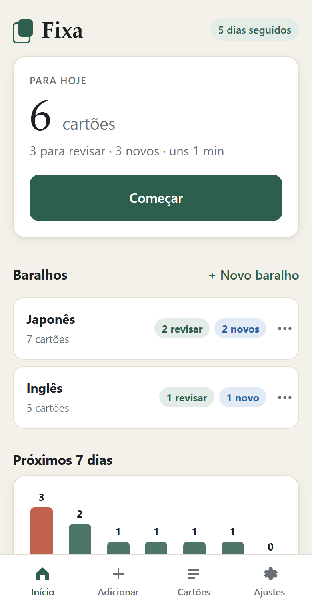
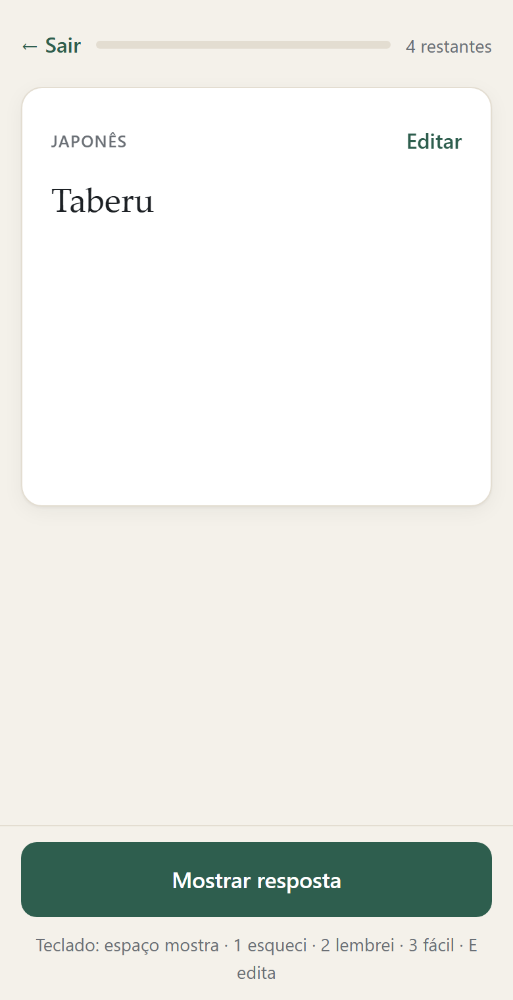
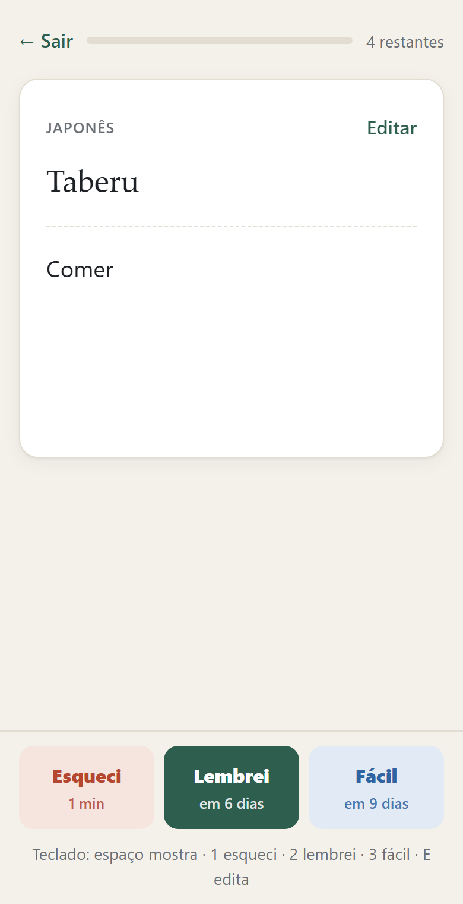
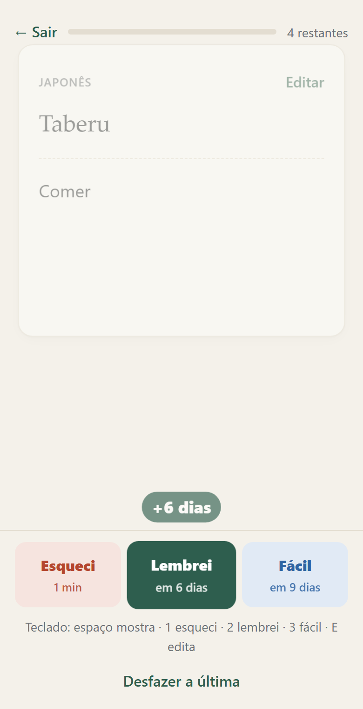
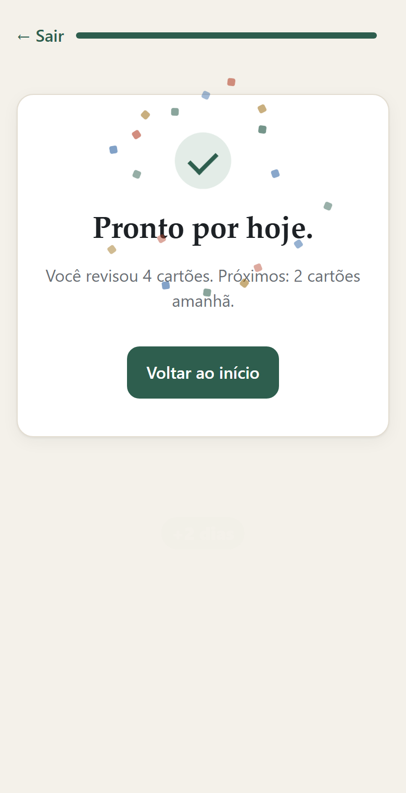

# Fixa

Cartões de revisão espaçada numa tela simples. Você cria os cartões, o app decide quando cada um volta — logo antes de
você esquecer. Funciona no navegador, instala no celular como app e também sai como APK para Android. **Nada sai do
aparelho**: não há servidor, conta nem rastreamento.

| Início | Pergunta | Resposta | Respondeu | Fim |
|---|---|---|---|---|
|  |  |  |  |  |

## O que faz

- **Agenda cada cartão com o FSRS-6**, um algoritmo aberto de repetição espaçada. Para cada cartão ele guarda a
  *estabilidade* (dias até a chance de lembrar cair para 90%) e a *dificuldade*, e atualiza as duas a cada resposta.
  Um cartão que você sempre lembra volta em 2, 11, 46 e 163 dias; se esquecer, recua para 3 dias e reconstrói.
- **Três botões**: Esqueci, Lembrei, Fácil. Cada um mostra quando o cartão volta. Esqueci traz o cartão de novo em um
  minuto, na mesma sessão.
- **Imagem e áudio** em qualquer lado do cartão: arquivo, print colado com Ctrl+V ou áudio gravado na hora.
- **Baralhos** com limite de cartões novos por dia em cada um.
- **Animações curtas** ao virar, ao responder e no fim da sessão — e nenhuma para quem liga "reduzir movimento".
- **Desfazer** a última resposta e **editar** o cartão sem sair do estudo.
- **Colar vários** cartões de uma vez (`frente | verso`, ou texto separado por tabulação).
- **Backup** num arquivo, com a mídia junto. Modo claro e escuro.

## Como é feito

| Peça | Escolha |
|---|---|
| App | HTML, CSS e JavaScript puros. Sem framework, sem etapa de build |
| Agendador | [`fsrs.js`](fsrs.js): o FSRS-6 reescrito a partir das fórmulas publicadas, ~100 linhas |
| Dados | Texto no `localStorage`; imagem e áudio no IndexedDB, com foto reduzida para 1280 px |
| Instalável | PWA (manifest + service worker): abre sem internet depois da primeira visita |
| Android | [`android/`](android/): uma Activity com WebView que leva o site dentro do APK. **Sem permissão de internet** — só o microfone, para gravar áudio |

## Rodar

```bash
python -m http.server 8000   # e abrir http://localhost:8000
```

Para instalar no celular a partir do site, ele precisa estar publicado em HTTPS. Ou baixe o APK em
[Releases](../../releases). Para montar o APK você mesmo, veja [`android/LEIA-ME.md`](android/LEIA-ME.md).

## Testes

| Comando | O que confere |
|---|---|
| `node teste/fsrs.test.js` | o agendador contra os valores esperados da implementação de referência do FSRS-6 |
| `python teste/fluxo.py` | o app inteiro num Chrome sem janela: criar, colar, estudar, desfazer, mídia, backup |
| `python teste/animacao.py` | as animações, com e sem "reduzir movimento" |
| `python teste/apk_ponte.py` | a conversa do site com a casca Android, simulada |

Os testes em Python usam [Playwright](https://playwright.dev/python/). `python ferramentas/telas.py` refaz as telas
deste README.

## Créditos

O algoritmo FSRS é do projeto [Open Spaced Repetition](https://github.com/open-spaced-repetition). As fórmulas e os
parâmetros padrão vêm da implementação de referência
[`fsrs-rs`](https://github.com/open-spaced-repetition/fsrs-rs/tree/v6.6.2) (BSD-3-Clause); o código deste projeto foi
escrito do zero.

## Licença

[MIT](LICENSE). Use, copie e modifique à vontade; o software é fornecido como está, sem garantia, e o autor não
responde por danos do uso.
