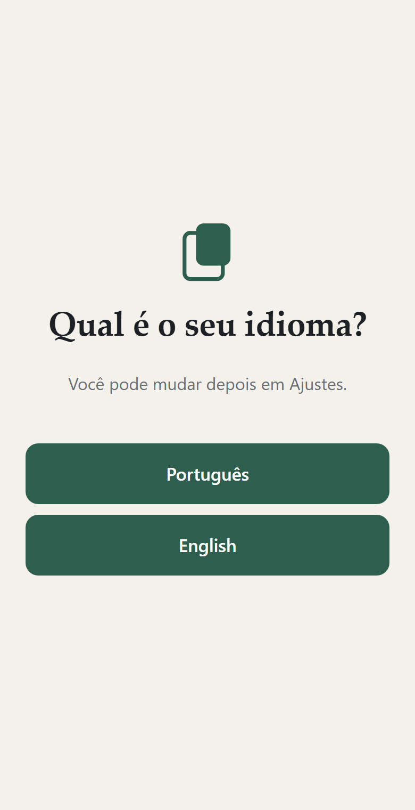
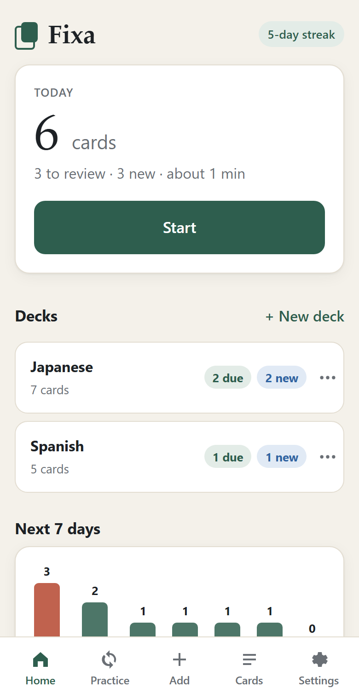
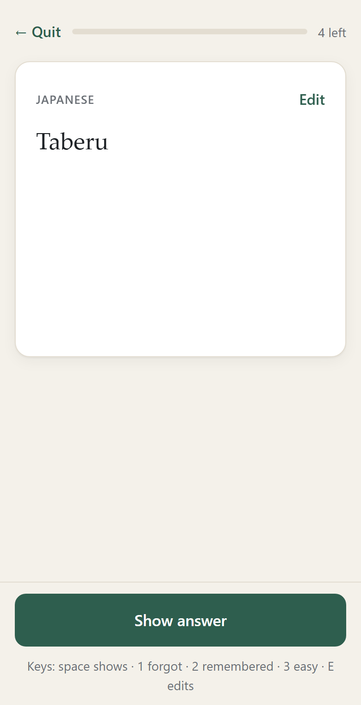
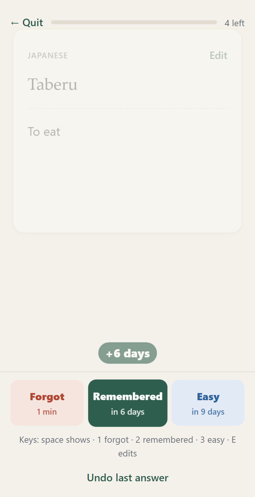
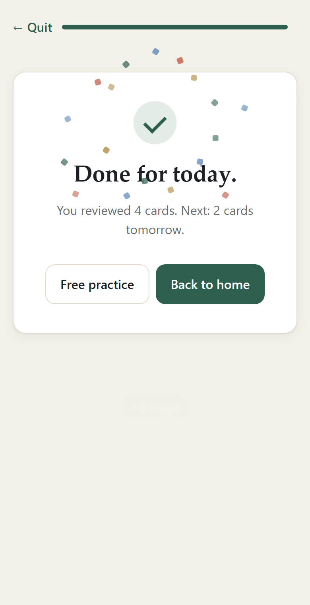

# Fixa

Spaced repetition flashcards for Android, on a simple screen. You write the cards; the app decides when each one
comes back — right before you would forget it. **Nothing leaves the phone**: no server, no account, no tracking.
Available in **English** and **Portuguese**.

| Pick a language | Home | Question | Answer | Rated | Done |
|---|---|---|---|---|---|
|  |  |  |  |  |  |

## Features

- **Schedules every card with FSRS-6**, an open spaced repetition algorithm. For each card it tracks *stability*
  (days until your chance of recall drops to 90%) and *difficulty*, and updates both after every answer. A card you
  always remember comes back after 2, 11, 46 and 163 days; forget it and it drops back to 3 days and rebuilds.
- **Three buttons**: Forgot, Remembered, Easy. Each shows when the card will return. Forgot brings the card back in
  one minute, in the same session.
- **Images and audio** on either side of a card: pick a file, paste a screenshot with Ctrl+V, or record on the spot.
- **Decks**, each with its own daily limit of new cards.
- **Bilingual**: on first run the app asks for your language, in your phone's language; you can switch any time.
- **Short animations** when flipping, rating and finishing a session — and none for users who turn on "reduce motion".
- **Undo** the last answer and **edit** a card without leaving the session.
- **Paste many** cards at once (`front | back`, or tab-separated text).
- **Backup** to a file, media included. Light and dark mode.

## Install on Android

1. On your phone, open the [download link](https://github.com/motascientist/fixa/releases/latest/download/fixa.apk)
   (or go to [Releases](https://github.com/motascientist/fixa/releases)).
2. Open the downloaded `fixa.apk`. If Android asks, allow installs from that source.
3. Tap **Install**. If Play Protect says it doesn't know the app, choose **Install anyway**.

The APK has no internet permission — your cards stay on the phone. The only permission is the microphone, to record audio.

## How it's built

| Part | Choice |
|---|---|
| App | Plain HTML, CSS and JavaScript. No framework, no build step |
| Scheduler | [`fsrs.js`](fsrs.js): FSRS-6 rewritten from the published formulas, ~100 lines |
| Languages | [`i18n.js`](i18n.js): every interface string in English and Portuguese, with plural forms |
| Data | Card text in `localStorage`; images and audio in IndexedDB ([`media.js`](media.js)), photos shrunk to 1280 px |
| Android | [`android/`](android/): one Activity with a WebView that carries the app inside the APK. **No internet permission**. To build it yourself, see [`android/README.md`](android/README.md) |

## Tests

| Command | What it checks |
|---|---|
| `node tests/fsrs.test.js` | the scheduler against the expected values of the FSRS-6 reference implementation |
| `python tests/flow.py` | the whole app in a headless Chrome: language, decks, pasting, studying, undo, media, backup |
| `python tests/language_and_upgrade.py` | the language picker, live switching, and upgrading data saved by v0.1.0 |
| `python tests/animation.py` | the animations, with and without "reduce motion" |
| `python tests/android_bridge.py` | the web app's side of the Android bridge, simulated |

The Python tests use [Playwright](https://playwright.dev/python/). `python tools/screenshots.py` regenerates the
screenshots in this README.

## Credits

The FSRS algorithm comes from the [Open Spaced Repetition](https://github.com/open-spaced-repetition) project. The
formulas and default parameters follow the reference implementation
[`fsrs-rs`](https://github.com/open-spaced-repetition/fsrs-rs/tree/v6.6.2) (BSD-3-Clause); the code in this repository
was written from scratch.

## License

[MIT](LICENSE). Use, copy and modify freely; the software is provided as is, without warranty, and the author is not
liable for any damage arising from its use.
